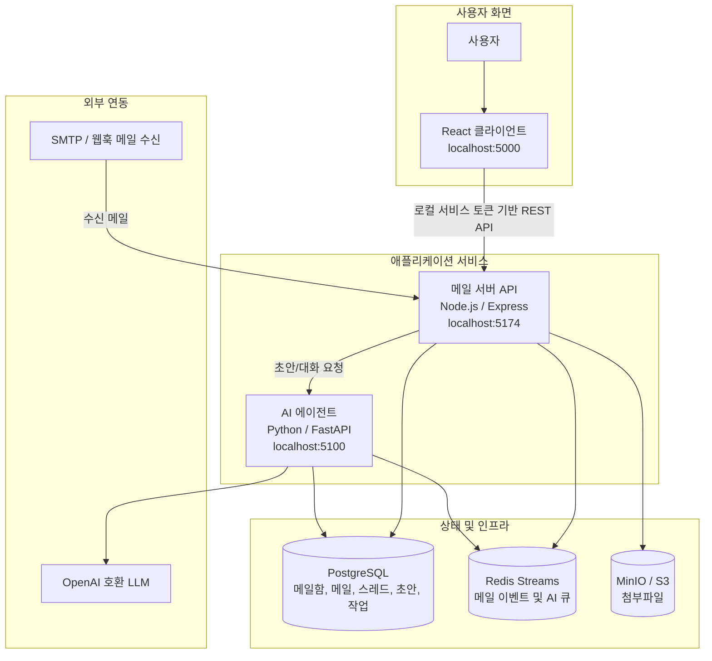
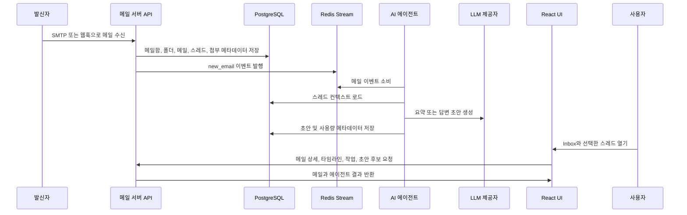
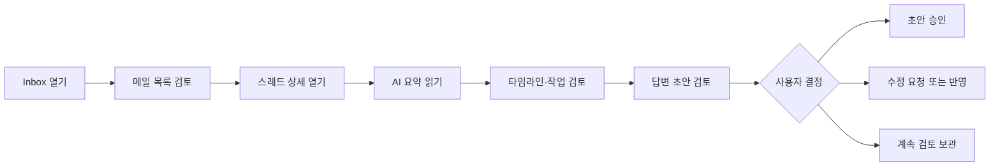
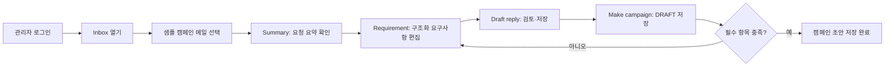

# Agent Mail — Replit 운영 배포용 소스 패키지

한국어 캠페인 요청 메일을 검토하고, 요약·답변 초안·요구사항·캠페인 초안을 관리하는 Inbox입니다.

**[English guide: README.md](README.md)**

이 폴더 **전체를 GitHub 저장소의 최상위**로 사용하세요. `github-version/`만 따로 올리면 Replit 설정과 Python 의존성 파일이 누락됩니다.

## 1. 패키지 상태와 범위

- 최초 작성: **2026-11-03**. 개정: **2026-11-26** — 고친 것은 [2.1](#21-2026-11-26-개정에서-고친-것)에 있고, Replit에 이 개정을 반영하기 전에 확인할 일도 그곳에 있습니다.
- Replit용 운영 빌드·실행 경로와 관리자 로그인을 포함합니다.
- 기존 Cloudflare Workers 소스와 관련 문서는 보존했습니다.
- 실제 메일 발송, 실제 캠페인 집행, 운영 환경의 실제 AI 호출은 **활성화하지 않았습니다**.
- 캠페인 분석 버튼은 포함된 9개 시나리오를 대상으로 동작합니다. 일반 메일을 분석하는 LLM 연동은 별도 작업입니다.
- 이 파일은 **운영 배포용 소스**입니다. 실행 파일 묶음이나 현재 서버/데이터베이스의 백업이 아닙니다. Replit에서 의존성을 설치하고 빌드합니다.
- **게시 완료본이 아닙니다.** 현재 원본 작업공간에서는 포트 변경이 재시작 후 원복되는 문제가 남았습니다. 이 패키지에는 올바른 포트 설정을 넣었지만, 새로 가져온 환경에서도 실제 매핑을 확인해야 합니다.
- 현재 데이터베이스의 메일·저장된 답변·세션·첨부파일은 포함하지 않았습니다. 샘플 생성 코드, 정적 예시 이미지, SQL 마이그레이션은 포함합니다.

> 문서 우선순위: **이 README → 실제 Replit 전용 실행 스크립트 → 기존 문서**.
> `github-version/README.md`, `DEPLOYMENT.md`, `OPERATIONS.md`와 하위 문서는 기존 Cloudflare/Docker 구성을 설명합니다. 기존 문서의 SMTP·AI·Docker 운영 안내가 이 Replit 운영 경로에 그대로 적용되는 것은 아닙니다.

## 2. 기존 내용 대비 Changelog

아래는 기존 Cloudflare/Docker 중심 구성과 이번 Replit 패키지의 기능 차이입니다. 전체 upstream Git 이력을 대체하는 커밋 목록은 아닙니다.

| 항목 | 기존 구성/설명 | 이번 패키지 |
|---|---|---|
| 운영 배포 | Cloudflare Workers 또는 별도 Node/Python/Docker 서비스 | Replit Autoscale용 Node 웹/API 서버 분리 |
| 프런트엔드 빌드 | Cloudflare 플러그인을 사용하는 기본 빌드 | Replit 전용 SPA 빌드, `build-replit/client/` 출력 |
| 운영 인증 | Cloudflare Access JWT 및 서비스 인증 | 단일 관리자 비밀번호와 PostgreSQL 세션 |
| 로그인 보호 | Replit 전용 로그인 경로 없음 | 비밀번호 검증, 8시간 세션, 로그아웃, 15분당 로그인 시도 제한 |
| 브라우저 인증 | 개발용 프록시와 서비스 토큰 사용 | 운영 빌드에 개발 토큰을 넣지 않음; Secure/HttpOnly 쿠키 사용 |
| 캠페인 메일 | 기존 메일함/일반 메일 기능 | LG전자·삼성전자·대한항공 시나리오 9건 생성 코드 |
| 메일 본문 | 일반 HTML/텍스트 본문 | 상품, 대상, 채널, 일정, 요청사항 및 이미지 예시가 포함된 본문 |
| 캠페인 검토 | 일반 메일/AI 액션 | `Summary`, `Draft reply`, `Requirement`, `Make campaign` |
| 초안/요구사항 | 기존 메일 데이터 모델 | 캠페인 작업공간과 편집 결과 저장; 필수 정보 누락 안내 |
| 첨부파일 | 개발 MinIO/S3 경로 | 운영에서 외부 HTTPS S3 설정을 요구하며, 미설정 시 명시적으로 실패 |
| 실제 메일 발송 | 기존 SMTP 관련 코드 존재 | Replit 운영 경로의 발송·답장 발송·전달 차단 |
| 실제 AI/메일 수신 | Python AI·SMTP·웹훅 코드 존재 | Replit 운영에서 서비스 미연결 응답; 관련 서비스 기동 안 함 |
| DB 변경 | 기존 SQL 마이그레이션 | 캠페인 작업공간과 웹 인증 마이그레이션 추가; 운영 기동 중 DDL 실행 금지 |
| GitHub 배포 묶음 | 애플리케이션 폴더 중심 | 최상위 Replit 설정, 한국어 안내, 운영용 CI, 파일 무결성 목록 포함 |

의존성 잠금 파일과 기존 보안 관련 수정도 그대로 포함합니다. 이 배포 묶음이 새로운 전체 보안 감사를 통과했다는 의미는 아닙니다.

### 2.1 2026-11-26 개정에서 고친 것

첫 패키지를 품질 감사하니 캠페인 검토 흐름은 동작했지만, 그 주변의 일반 메일함 기능 대부분이 이 빌드에서 동작하지 않았습니다. 모든 지적은 고치기 전에 실제 서버에서 재현했습니다. 사용자가 체감하는 변화는 다음과 같습니다.

| 영역 | 2026-11-03까지 | 2026-11-26부터 |
|---|---|---|
| 빈 받은 메일함 | 샘플 캠페인을 만들 방법이 없었고, README는 브라우저 콘솔용 스크립트를 안내 | 빈 받은 메일함이 **샘플 캠페인 9건 불러오기**를 제안하고 직접 불러옴 |
| 검색 | 모든 검색이 실패했는데 "결과 없음"으로 표시 | 동작함. 검색창이 안내하는 연산자도 동작. 실패하면 실패라고 말하고 다시 시도를 제안 |
| 읽음·별표 | 누르면 바로 원복 | 유지됨. 읽지 않음 뱃지와 별표 아이콘도 따라감 |
| 메일 상세 패널 | 별표 상태와 날짜가 표시되지 않음 | 둘 다 표시 |
| 초안 | 두 번 저장하면 초안이 두 개, 다시 열면 본문이 없음, 스레드 안의 회신 초안은 보낸 메일처럼 보임 | 메시지당 초안 하나, 본문이 돌아옴, 스레드 안의 초안에 Edit·Discard 표시 |
| 받은 메일함 밖에서 Compose | 설정·admin·Inbox Zero 화면에서는 Compose 버튼과 Reply가 반응하지 않음 | 그 화면들에서는 대화상자로 작성기가 열림 |
| 발송과 AI | 기본 동작으로 제시됐다가 서버가 거부 | 이 빌드에서는 제시하지 않음. **Save as Draft**가 기본 동작이고 Reply·Forward는 여전히 작성기를 엶 |
| Cost Dashboard | Dashboard의 링크가 404로 이동 | 열림 |
| admin 폼 | 저장이 거부돼도 아무 표시가 없음 | 이유를 보여 주고 입력값을 지킴 |
| 운영 게이트 | `POST …/emails/send`와 AI 피드백·사용량 쓰기가 차단되지 않았음 | 다른 발송·AI 경로와 같이 차단 |
| 에러 | 형식이 틀린 id나 실패한 저장이 DB 원문과 함께 500 | 경로의 형식이 틀린 id는 404, 본문의 id는 400. 서버 오류는 실패했다는 사실만 알리고 원인은 로그에. 호출자 실수는 이유를 알려 줌 |
| 메일이 많을 때 고객 페이지 | 고객의 관련 메일 조회가 저장된 모든 본문에 비례 (22KB 메일 2만 건에서 1.1초) | 수 밀리초 |

내부 변경: 메일 행은 어느 엔드포인트에서든 한 가지 형태. 목록은 더 이상 본문을 싣지 않음(샘플 9건 기준 127KB → 11KB). admin 쓰기는 트랜잭션. CI에 타입 검사, 클라이언트 단위 테스트, 실제 PostgreSQL을 대상으로 한 계약 테스트가 포함됨.

**이 개정을 Replit에 반영하기 전에:**

1. **Replit 워크스페이스가 그사이 바뀌지 않았는지 확인하세요.** 이 개정은 2026-11-14에 push한 패키지를 이어받습니다. 그 뒤로 Replit에서 작업공간을 수정했다면 pull이 충돌하거나 그 작업을 덮어씁니다. 먼저 브랜치에서 합치세요.
2. **마이그레이션 007이 유니크 인덱스를 추가합니다**(메일 1건당 요청 작업 1개). 운영에서는 자동으로 실행되지 않고, 그전처럼 Replit Publish로 스키마가 전달됩니다. 마이그레이션이 `could not create unique index "idx_admin_tasks_mailbox_email_once"`로 멈추면 같은 메일에 작업이 두 개 있다는 뜻입니다. 마이그레이션은 일부러 아무것도 삭제하지 않습니다. 그 둘을 찾는 쿼리는 마이그레이션 파일 안에 있습니다.
3. **이 빌드에서는 발송을 더 이상 제시하지 않습니다.** 이 배포에서 그것을 원하지 않는다면 반영 전에 알려 주세요.

### 2.2 의도적으로 그대로 둔 것

- Cloudflare Workers 배포 대상(`client/workers/`, `wrangler.jsonc`, Cloudflare 빌드 설정)은 보존됩니다. `wrangler.jsonc`에는 운영 도메인이 적혀 있습니다. 이를 retire하는 것은 소유자의 결정입니다.
- 사이드바는 세 그룹에 링크 18개입니다. first-run audit 기준(8개 이하)을 넘고, 메인 그룹만 보면 7개입니다. 여기서는 재설계하지 않았습니다.
- `smtp_config`와 `ai_conversations` 테이블은 읽는 곳이 없습니다. 테이블을 DROP하는 것은 데이터 삭제라 하지 않았습니다.
- 고객 페이지에서는 메일 본문의 회사명이 그 단어들이 **이어져** 나올 때만 일치합니다(각 단어가 온전한 단어이거나 단어의 시작이어야 함). 더 긴 단어 가운데 묻힌 회사명, 두 단어가 서로 다른 곳에 나오는 두 단어 회사명은 더 이상 일치하지 않습니다. 주소와 제목의 일치는 그전과 같습니다.

## 3. 폴더 구조

```text
agent-mail-replit/
├── README.md                         # 영어 안내서
├── README.ko.md                      # 이 안내서(한국어)
├── VALIDATION.md                     # 패키지 검증 결과
├── RELEASE-MANIFEST.sha256           # 배포 파일별 SHA-256
├── .replit                          # 개발 워크플로 + 운영 게시 설정
├── .gitignore / .replitignore
├── .env.example                     # Replit 설정 항목 안내; 실제 값 없음
├── .github/workflows/
│   └── replit-production.yml         # 타입 검사, PostgreSQL 대상 테스트, 운영 빌드; 배포는 하지 않음
├── pyproject.toml / uv.lock          # 개발용 Python 의존성
├── src/                             # 기존 Python 패키지 보조 소스
└── github-version/
    ├── client/                      # Inbox UI, 공유 캠페인 데이터, Cloudflare 소스
    ├── mail-server/                 # Express API, 인증, SQL, 테스트
    │   ├── migrations/              # 001–007; 007 = 메일 1건당 요청 작업 1개
    │   └── tests/e2e/               # TEST_DATABASE_URL 대상으로 실제 서버를 띄움
    ├── ai-agent/                    # 기존 Python AI 소스; 운영에서는 기동 안 함
    ├── scripts/
    │   ├── post-merge.sh            # 의존성 설치
    │   ├── start-replit.sh          # 비공개 개발 미리보기
    │   ├── build-replit.sh          # Replit 운영 SPA 빌드
    │   └── start-production.sh      # Replit 운영 Node 서버
    ├── pnpm-lock.yaml
    ├── pnpm-workspace.yaml
    ├── package.json
    └── docs/                        # 기존 설계 및 변경 문서
```

`docker-version/` 복제본, `.git` 이력, 개발자 메모, 런타임 데이터, `node_modules/`, `.pythonlibs/`, 캐시, 기존 빌드 결과는 제외했습니다. `github-version/` 안의 원래 Docker/Cloudflare 관련 소스와 예제는 호환성 참고용으로 남겼습니다.

## 4. 서비스 아키텍처

아래 전체 시스템 다이어그램은 [`github-version/README.md`](github-version/README.md)와 공유합니다. 애플리케이션 전체를 설명하며, 실제로 어디까지 기동하는지는 환경에 따라 다릅니다. 아래 [환경별 런타임](#환경별-런타임) 표를 함께 확인하세요. Replit 운영 경로에서는 수신/AI/큐 서비스를 의도적으로 기동하지 않습니다.

### 서비스 구성



### 메일 에이전트 워크플로



Replit 운영 경로에서는 첫 단계(SMTP/웹훅 수신)와 AI 에이전트/LLM 호출이 연결되어 있지 않습니다(`503 SERVICE_NOT_CONFIGURED`). 실시간 LLM 분석 대신 포함된 캠페인 시나리오가 검토 액션을 구동합니다.

### 사용자 흐름

일반 Inbox 검토 흐름:



현재 Replit Inbox의 캠페인 검토 흐름 (발송·게시 없음):



### 환경별 런타임

| 구성 요소 | 개발 미리보기 (`start-replit.sh`) | Replit 운영 (`start-production.sh`) |
|---|---|---|
| React 클라이언트 | Vite 개발 서버 `0.0.0.0:5000` | 단일 Node 웹/API 서버가 빌드된 SPA 서빙 |
| 메일 서버 API | `127.0.0.1:5174` (내부) | 웹/API 서버로 통합, `0.0.0.0:5000` |
| 브라우저 인증 | 개발 프록시 + 고정 로컬 서비스 토큰 (비공개 유지) | 관리자 비밀번호 로그인, PostgreSQL 세션, Secure/HttpOnly 쿠키 |
| AI 에이전트 (Python) | `127.0.0.1:5100` (내부) | 기동 안 함; 엔드포인트는 `503 SERVICE_NOT_CONFIGURED` |
| PostgreSQL | Replit 제공 개발 DB | Replit 제공 운영 DB; 스키마는 Publishing으로 반영 |
| Redis | 로컬 개발 서비스 (이벤트/큐) | 기동 안 함 |
| MinIO / S3 | 로컬 개발 MinIO (`.runtime/`) | 기동 안 함; 첨부파일은 외부 HTTPS S3 설정 필요 |
| SMTP 수신/발송 | 기동 안 함 | 발송 차단(`403 SENDING_DISABLED`), 수신 미연결(`503`) |

## 5. GitHub에 올리는 방법

### 새 빈 저장소

GitHub에서 비어 있는 저장소를 만든 뒤, 압축을 푼 폴더에서 실행합니다.

```bash
cd agent-mail-replit
git init -b main
git status --short
git add .
git diff --cached --stat
git commit -m "Prepare Agent Mail for Replit production"
git remote add origin https://github.com/YOUR_OWNER/YOUR_REPOSITORY.git
git push -u origin main
```

`YOUR_OWNER/YOUR_REPOSITORY`는 실제 저장소로 바꾸세요. 비밀번호나 GitHub 토큰을 명령어/README에 넣지 마세요.

### 기존 저장소에 반영

기존 저장소를 clone하고 **새 브랜치에서** 이 패키지를 반영한 뒤 변경사항을 검토하세요. 기존 저장소 루트가 `client/`, `mail-server/` 형태라면 이번 패키지의 루트 구조가 다릅니다. 기존 파일을 무작정 덮어쓰거나 `git push --force`로 이력을 교체하지 마세요.

이 패키지는 GitHub에 자동으로 push하지 않습니다. 최상위 CI도 테스트/빌드만 수행하며 Cloudflare나 Replit에 자동 게시하지 않습니다. 중첩된 기존 `.github/` 폴더는 원본 참고용이며 GitHub 최상위 워크플로로 옮기지 않는 한 실행되지 않습니다.

## 6. Replit 개발 환경 설치

### 6.1 가져오기 및 준비

1. [Replit Import](https://replit.com/import)에서 GitHub 저장소를 가져옵니다.
2. Node.js **22**, pnpm **10.32.1**, Python **3.12**, uv를 사용합니다. `.replit`에는 필요한 런타임과 Redis/MinIO 등 Nix 패키지 설정이 들어 있습니다.
3. 이 프로젝트에 사용할 PostgreSQL 개발 데이터베이스 연결이 준비되어 있는지 확인합니다. 제공되는 `DATABASE_URL`을 사용하고 연결 값을 Git에 기록하지 않습니다. 기존 외부 DB를 사용하는 경우 임의로 다른 DB로 교체하지 않습니다.
4. Replit Secrets에 아래 필수 비밀값을 **새로** 설정합니다. ZIP에는 원본 작업공간의 비밀값이 들어 있지 않습니다.
5. 저장소 최상위에서 의존성을 설치합니다.

```bash
bash github-version/scripts/post-merge.sh
```

이 스크립트는 고정된 pnpm/uv 잠금 파일로 설치합니다. DB 초기화나 서버 기동은 하지 않습니다.

### 6.2 필수 설정

| 이름 | 개발 | 운영 | 설명 |
|---|---|---|---|
| `DATABASE_URL` | 필수 | 필수 | 해당 환경의 PostgreSQL 연결. Replit 관리 DB는 제공된 연결 사용 |
| `SESSION_SECRET` | 필수 | 필수 | 32자 이상의 충분히 긴 무작위 비밀값 |
| `INBOX_ADMIN_PASSWORD` | 개발 미리보기에서는 미사용 | 필수 | 관리자 로그인용, 16~1024자. 세션 비밀값과 반드시 별도 값 사용 |
| `PORT` | 실행 스크립트에서 지정 | 기본 `5000` | 명시적으로 설정했다면 Networking과 일치시켜야 함 |
| `S3_ENDPOINT` | 개발 실행기가 로컬 값 설정 | 첨부 저장소 사용 시 필수 | 외부에서 사용 가능한 HTTPS S3 호환 엔드포인트 |
| `S3_BUCKET` | 동일 | 동일 | 외부 영구 저장 버킷 |
| `S3_ACCESS_KEY`, `S3_SECRET_KEY` | 동일 | 동일 | 버킷 최소 권한 자격증명 |
| `S3_REGION` | 선택 | 선택 | 저장소 제공자 요구에 맞게 설정 |

운영용 `OPENAI_API_KEY`, SMTP 비밀번호는 현재 기능 범위에 필요하지 않습니다. 값을 추가하는 것만으로 비활성화된 운영 AI/발송 경로가 켜지지는 않습니다.

`.env.example`은 항목 설명용입니다. Replit에서는 Secrets/환경변수 관리 화면을 사용하세요. 예제 파일을 그대로 실제 설정으로 사용하지 마세요. `VITE_*` 변수에 비밀번호나 키를 넣지 마세요.

### 6.3 개발 미리보기

```bash
bash github-version/scripts/start-replit.sh
```

또는 Run으로 `Agent Mail` 워크플로를 시작합니다.

- 프런트엔드: `0.0.0.0:5000`
- 내부 메일 API: `127.0.0.1:5174`
- 내부 Python AI API: `127.0.0.1:5100`
- Redis/MinIO: 로컬 개발용 서비스
- 시작 시 **개발 DB**에 필요한 마이그레이션을 적용합니다.

**개발 미리보기는 반드시 비공개로 유지하세요.** 개발 프록시는 고정된 로컬 관리자 권한을 부여합니다. 이 개발 스크립트를 운영 실행 명령으로 사용하면 안 됩니다.

## 7. Inbox 사용법

### 7.1 샘플 캠페인 메일 생성

현재 DB의 메일은 ZIP에 포함되지 않습니다. 새 환경에서는 받은 메일함에서 직접 불러옵니다.

**받은 메일함에서.** 받은 메일함이 비어 있는 메일함을 여세요. 빈 상태 화면이 샘플의 용도를 설명하고 **샘플 캠페인 9건 불러오기**를 제안합니다. 누르면 목록과 폴더 수가 새로 고쳐지고, 안내 메시지가 다음 단계(메일 열기)를 알려 줍니다. 다시 눌러도 추가되지 않습니다. 기존 DB가 연결되어 있으면 의도한 메일함에서만 하세요.

**엔드포인트 직접 호출.** 버튼은 직접 호출할 수 있는 같은 엔드포인트를 씁니다. 사이트에 로그인한 뒤(또는 개발 미리보기를 연 뒤) 그 세션으로 동일 출처 요청을 보내면 됩니다. 아래 ID는 최초 마이그레이션의 샘플 메일함 ID이며, 다른 메일함을 사용할 때는 실제 ID로 바꾸세요.

```js
const mailboxId = "00000000-0000-0000-0000-000000000001";
const response = await fetch(
  `/api/v1/mailboxes/${encodeURIComponent(mailboxId)}/demo-campaigns/seed`,
  {
    method: "POST",
    headers: { "Content-Type": "application/json" },
    body: JSON.stringify({ refreshContent: false }),
  },
);
if (!response.ok) throw new Error(`샘플 생성 실패: ${response.status}`);
console.log(await response.json());
location.reload();
```

어느 쪽도 서버 인증을 우회하거나 비밀번호를 브라우저에 넣지 않습니다. 운영에서는 둘 다 정상 로그인 세션과 동일 출처 HTTPS 요청이 필요합니다. 반복 호출 시 기존 샘플을 중복 생성하지 않습니다. `refreshContent: true`는 기존 샘플 본문을 갱신하므로, 본문 갱신이 필요한 경우에만 사용하세요.

이 버튼이 제품 안에서 샘플을 만드는 유일한 곳입니다. 캠페인 버튼 4개는 다른 메일에는 나타나지 않으므로, 샘플이 없는 메일함에는 할 캠페인 검토가 없습니다.

### 7.2 포함된 시나리오

| 기업 | 상품/서비스 예시 | 요청 유형 |
|---|---|---|
| LG전자 | OLED, 퓨리케어, 코드제로 | 신제품 런칭, 구독 안내, 상품 안내 |
| 삼성전자 | Galaxy, BESPOKE, Buds | 신제품 런칭, 구독 안내, 상품 안내 |
| 대한항공 | 신규 노선, 소식 구독, 도쿄 노선 | 신규 서비스 안내, 구독 안내, 노선 상품 안내 |

총 9건이며 `Popup`, `Web push`, `Inline banner` 요청을 포함합니다. 상품 관련 본문과 정적 이미지 예시를 함께 제공합니다.

이 시나리오는 실제 기업이 보낸 요청이 아니며, 동봉 이미지는 캠페인 검토용 예시입니다. 실제 광고·외부 공개에 사용하기 전 상표, 상품 이미지, 콘텐츠 이용 권한을 별도로 확인하세요.

### 7.3 메일 상단의 네 가지 버튼

1. **Summary**: 선택한 샘플의 상품, 캠페인 목적, 채널 등 요청 요약을 확인합니다.
2. **Draft reply**: 답변 초안을 검토·수정하고 저장합니다. **메일을 보내지 않습니다.**
3. **Requirement**: 대상, 일정, 링크 등 구조화된 요구사항을 확인·수정합니다. 확인된 정보와 미확인/누락 정보를 검토하세요.
4. **Make campaign**: 요구사항을 바탕으로 캠페인 **DRAFT**를 저장합니다. 필수 항목이 부족하면 보완이 필요합니다. 실제 팝업 게시나 푸시 발송은 하지 않습니다.

요구사항 변경 후 이전 캠페인 초안이 오래된 상태로 표시되면 현재 요구사항으로 다시 저장하세요. 네 버튼은 인식 가능한 샘플 캠페인 메일에서 표시됩니다. 일반 메일에 같은 AI 결과가 자동 생성된다고 기대하면 안 됩니다.

## 8. Replit 운영 빌드와 게시

### 8.1 운영 명령

저장소 최상위 기준:

```bash
# 운영용 프런트엔드 생성 + 고정 의존성 설치
bash github-version/scripts/build-replit.sh

# 이미 빌드되고 DB 스키마/환경변수가 준비된 운영 환경에서 실행
bash github-version/scripts/start-production.sh
```

빌드 결과: `github-version/client/build-replit/client/`.

운영 실행기는 `NODE_ENV=production`, `APP_ENV=production`, `REPLIT_WEB_ENABLED=true`, `RUN_MIGRATIONS=false`, `SMTP_INBOUND_ENABLED=false`를 설정합니다. **Node 웹/API 서버 하나만 실행**하며 Vite, Redis, MinIO, Python, SMTP 서버는 기동하지 않습니다.

운영 로그인은 HTTPS와 Secure 쿠키를 전제로 합니다. 평문 `http://localhost`로 운영 로그인을 시험하고 정상 배포와 같다고 판단하지 마세요.

### 8.2 Publishing 설정

| 설정 | 값 |
|---|---|
| 배포 유형 | Autoscale |
| Build command | `bash github-version/scripts/build-replit.sh` |
| Run command | `bash github-version/scripts/start-production.sh` |
| 공개 서버 | `0.0.0.0:5000` |
| 외부 포트 | **내부 5000 → 외부 80 하나만** |
| 운영 DB 스키마 변경 | Publishing의 개발→운영 스키마 변경 검토/적용 |

게시 전에 Publishing의 **Production app secrets**에서 `SESSION_SECRET`, `INBOX_ADMIN_PASSWORD`와 필요한 설정을 다시 확인하세요. 새 프로젝트/운영 환경에 원본 작업공간의 Secrets가 이미 들어 있다고 가정하지 마세요.

개발 DB의 스키마를 먼저 준비하고, Publishing에서 제안하는 스키마 변경을 검토합니다. **운영 빌드·기동 스크립트에 마이그레이션 실행을 추가하지 마세요.** 최초 게시에서 제공되는 데이터 복사 옵션은 DB 종류/환경에 따라 다를 수 있습니다. 현재 DB를 샘플 때문에 덮어쓰지 말고, 필요한 경우 로그인 후 샘플 생성 API를 사용하세요.

배포 지역 선택이 제공된다면 첫 게시 전에 확인하세요. 지역은 첫 게시 후 변경할 수 없는 설정입니다. 실제 Publish 동작은 소유자가 수행해야 합니다.

### 8.3 포트 설정과 현재 알려진 문제

패키지의 `.replit`은 다음 상태로 구성했습니다.

```toml
[[ports]]
localPort = 5000
externalPort = 80

[[ports]]
localPort = 5174
exposeLocalhost = false
```

5174 항목은 **내부 전용**이며 외부 연결이 아닙니다. 나머지 개발 서비스도 내부 전용으로 명시했습니다.

원본 작업공간에서는 파일 변경이 검증되어도 재시작 후 `5000 → 5000`, `5174 → 80`으로 돌아왔습니다. 이는 이번 ZIP으로 해결된 사실이 아닙니다. 새로 가져온 환경에서도 다음을 확인하세요.

1. Networking에서 외부 매핑은 `5000 → 80` 하나만 남았는지 확인합니다.
2. Run 재시작 후에도 같은 설정인지 확인합니다.
3. 포트 번호가 없는 기본 개발 주소가 HTML 화면을 반환하는지 확인합니다.
4. 기본 주소가 `Missing or invalid local service token`과 함께 `401`을 반환하면 내부 API로 연결된 상태일 수 있습니다. 인증 검사를 제거하지 말고 매핑을 확인하세요.

문제가 재현되면 같은 파일 수정과 재시작을 반복하지 마세요. 설정 파일의 값과 Networking 화면의 실제 연결 상태를 구분해야 합니다.

### 8.4 게시 후 확인

- `/health`, `/ready`가 응답하고 DB 연결 상태가 정상인지 확인합니다.
- 로그아웃 상태에서 `/`는 로그인 화면을, `/api/v1/mailboxes`는 `401`을 반환해야 합니다.
- 관리자 로그인 후 Inbox와 본문 이미지가 열리는지 확인합니다.
- 답변/요구사항/캠페인 초안 저장 후 새로고침하여 유지되는지 확인합니다.
- 로그아웃 후 메일 API 접근이 다시 차단되는지 확인합니다.
- 실제 메일 발송은 `403 SENDING_DISABLED`, 미연결 AI/수신 경로는 `503 SERVICE_NOT_CONFIGURED`가 정상적인 현재 동작입니다. 2026-11-26부터 UI는 이들을 제시하지 않습니다. Send 버튼이 없고 AI 패널은 열리지 않습니다.
- 메일이 없는 메일함의 빈 받은 메일함에 **샘플 캠페인 9건 불러오기**가 있고, 한 번 누르면 메일 9건이 나열됩니다.
- 연 메일에서 별표를 누르면 페이지를 완전히 새로 고친 뒤에도 별표가 남고, 받은 메일함의 읽지 않음 수가 1 줄어듭니다.
- 머리글에서 검색하면 결과가 나옵니다.
- Reply를 누르면 인용된 메일이 담긴 작성기가 열리고, **Save as Draft**를 누르면 Drafts 폴더에 초안이 생깁니다.

`/`가 `200`이라는 사실만으로 로그인 설정이나 모든 기능이 준비됐다고 판단하지 마세요. 관리자 비밀번호가 없거나 길이가 맞지 않아도 안내 페이지는 표시되며 메일 API는 잠깁니다.

## 9. 운영·보안 설명서

### 로그인과 접근

- 현재 모델은 **단일 관리자 공유 Inbox**입니다. 사용자별 계정, 조직별 분리, MFA 기능은 포함하지 않습니다.
- 세션 쿠키는 Secure/HttpOnly/SameSite 속성을 사용합니다. DB에는 원본 세션 토큰 대신 해시를 저장합니다.
- 로그인 세션은 8시간 후 만료되며 로그아웃 시 서버 세션을 폐기합니다.
- `SESSION_SECRET` 또는 관리자 비밀번호를 변경하고 운영 앱에 반영하면 기존 세션이 무효화됩니다.
- 로그인 시도 제한은 PostgreSQL에 저장합니다. 반복 실패 시 15분 후 다시 시도하세요.
- 운영 쓰기 요청은 동일 출처 HTTPS Origin을 요구합니다. 임의의 사용자 식별 헤더나 개발 Bearer 토큰으로 운영 권한을 얻을 수 없습니다.
- Cloudflare 원래 경로의 Access 인증은 별도이며 Replit 관리자 비밀번호 방식으로 바뀌지 않았습니다.

### 데이터와 첨부파일

- 메일, 초안, 작업공간, 로그인 세션은 해당 PostgreSQL에 저장됩니다.
- DB 스키마 변경 전에 백업/복구 수단을 확인하고, 운영 데이터는 접근 권한과 보존 정책을 별도로 관리하세요.
- 개발 MinIO의 `.runtime/` 데이터는 운영으로 자동 복사되지 않습니다.
- 외부 영구 S3 저장소가 없으면 첨부파일 작업은 `503 STORAGE_NOT_CONFIGURED`로 실패합니다. **실제 첨부파일 운영은 미완료**입니다.
- 기존 첨부 객체를 옮길 때에는 DB의 객체 키와 실제 파일을 함께 보존하고 다운로드 권한을 검증해야 합니다.
- `/campaign-examples/`의 동봉 정적 이미지는 메일의 격리된 HTML 프레임에서도 로드되도록 공개됩니다. 사용자 첨부파일이 같은 경로로 공개되는 것은 아닙니다.

### 점검과 장애 대응

| 현상 | 확인할 사항 |
|---|---|
| 기본 주소가 API의 `401` 응답 | Networking이 5000이 아닌 내부 API로 연결됐는지 |
| 비밀번호 설정 안내 화면 | 운영 Secret 존재, 비밀번호 길이, 새 설정 반영 여부 |
| 로그인 후 다시 로그인 화면 | HTTPS, 쿠키, 외부 호스트, DB/세션 상태 |
| `relation does not exist` | 개발 스키마 준비 및 Publishing의 운영 스키마 반영 여부 |
| Inbox가 비어 있음 | 새 DB에는 원본 메일이 없음; 빈 받은 메일함이 샘플 캠페인 불러오기를 제안합니다 |
| Send 버튼·AI 패널이 없음 | 이 빌드에서 의도된 것입니다. 서버가 이 환경에서는 발송과 AI를 거부합니다 |
| 검색 화면에 "Search failed" | 요청이 거부된 것입니다. 화면의 문구가 서버가 준 이유입니다. "No results found"는 검색이 실행됐는데 일치가 없다는 뜻입니다 |
| API가 `500` | 응답에는 "Internal server error"만 있습니다. 원인은 그 요청의 서버 로그에 있습니다 |
| AI/메일 수신 `503` | 현재 운영 범위에서 의도적으로 미연결 |
| 첨부파일 `503` | 영구 S3 설정과 기존 객체 이전 필요 |
| 로컬 MinIO bucket 경고 | 개발 저장소 상태 점검; 운영 저장소가 준비됐다는 의미 아님 |
| 마이그레이션이 `could not create unique index "idx_admin_tasks_mailbox_email_once"`에서 멈춤 | 같은 메일에 요청 작업이 두 개 있습니다(마이그레이션 007). 그 둘을 찾는 쿼리는 그 마이그레이션 파일 안에 있습니다 |

로그에는 비밀번호, 연결 문자열, 세션 토큰을 남기지 마세요. 수정 후에는 해당 환경을 다시 실행/게시하고 실제 로그인·저장 경로를 확인하세요.

## 10. 테스트와 파일 검증

```bash
# 저장소 최상위에서 실행
pnpm --dir github-version install --frozen-lockfile
pnpm --dir github-version typecheck            # 클라이언트(react-router typegen 포함)
TEST_DATABASE_URL=<버려도 되는 PostgreSQL> pnpm --dir github-version test
bash -n github-version/scripts/build-replit.sh
bash -n github-version/scripts/start-production.sh
bash github-version/scripts/build-replit.sh

# 이 개정의 매니페스트와 파일 대조
sha256sum -c RELEASE-MANIFEST.sha256
```

`pnpm test`는 세 가지를 실행합니다. mail-server 단위 테스트, 계약 테스트, 클라이언트 단위 테스트입니다.

**계약 테스트**는 실제 운영 서버(실제 진입점과 실제 마이그레이션)를 `TEST_DATABASE_URL`에 띄우고 클라이언트가 보내는 요청을 보냅니다. 2026-11-03의 고장은 이 테스트가 잡았고, 단위 테스트로는 하나도 보이지 않던 것들입니다. 먼저 운영 SPA 빌드가 있어야 합니다(`build-replit.sh`). 운영 실행기는 빌드가 없으면 시작하지 않습니다. 데이터베이스는 이름에 `test`가 들어간 1회용 DB여야 합니다. 테스트가 거기에 쓰기를 하며, 다른 이름은 거부합니다. `TEST_DATABASE_URL`이 없으면 계약 테스트는 건너뛰고 어디에도 접속하지 않습니다.

GitHub Actions도 같은 순서로 돌립니다. 타입 검사, 빌드, PostgreSQL 서비스를 대상으로 한 테스트. 사용자의 DB에 마이그레이션을 실행하지 않고 배포도 하지 않습니다. 기존 Cloudflare 통합 테스트나 Python 테스트는 돌리지 않습니다.

`VALIDATION.md`에는 이 개정에서 실제로 수행한 검사와 하지 않은 검사를 기록했습니다. `RELEASE-MANIFEST.sha256`은 이 개정의 파일 목록입니다. 소스를 수정한 뒤에는 그 파일의 체크섬이 달라지는 것이 정상입니다.

## 11. 원본 코드·라이선스·참고 문서

- 기존 프로젝트 설명: [`github-version/README.md`](github-version/README.md)
- 기존 개발 문서: [`github-version/DEVELOPMENT.md`](github-version/DEVELOPMENT.md)
- 기존 배포 문서: [`github-version/DEPLOYMENT.md`](github-version/DEPLOYMENT.md)
- 기존 운영 문서: [`github-version/OPERATIONS.md`](github-version/OPERATIONS.md)
- Inbox AI 범위: [`github-version/client/docs/inbox-ai-spec.md`](github-version/client/docs/inbox-ai-spec.md)
- 보존된 클라이언트 라이선스: [`github-version/client/LICENSE`](github-version/client/LICENSE)
- [Replit 포트 설정](https://docs.replit.com/features/project-setup/ports)
- [Replit 개발/운영 데이터베이스](https://docs.replit.com/features/data-and-storage/development-and-production)
- [Replit Secrets](https://docs.replit.com/core-concepts/project-editor/app-setup/secrets)

기존 저작권·라이선스 고지를 유지했습니다. 이 패키지가 모든 이미지나 상표에 대한 사용 권한을 별도로 부여하는 것은 아닙니다.
