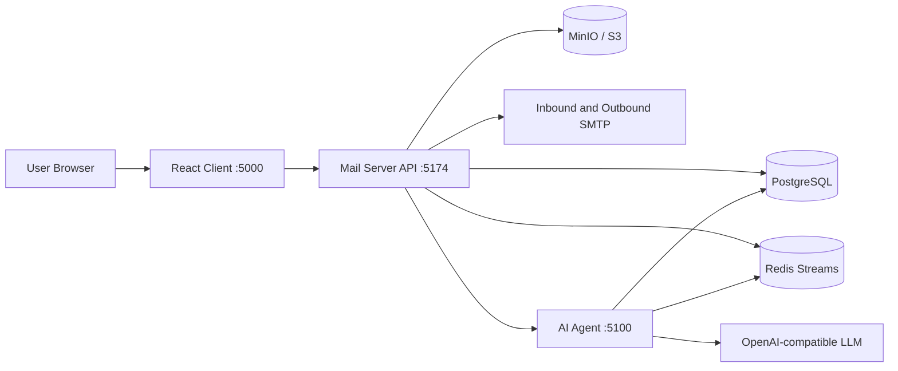

# Agent Mail Release Packages

This directory contains the two publishable Agent Mail packages prepared for `https://github.com/younghai/Agent-mail`.

## Package Split

- `github-version/` is the GitHub repository package. It contains the full source workspace, English README, GitHub Actions workflow, startup scripts, Docker Compose, and environment templates.
- `docker-version/` is the Docker-oriented package. It mirrors the same application code and documentation, but is intended for handoff to a server or Docker-only deployment bundle.

Both packages are source packages. They intentionally exclude real `.env` files, runtime logs, dependency folders, local caches, and machine metadata.

## Runtime Surface

- React UI: `http://localhost:5000`
- Mail Server API: `http://localhost:5174`
- AI Agent API: `http://localhost:5100`
- PostgreSQL: `localhost:5432`
- Redis: `localhost:6379`
- MinIO API: `localhost:9000`
- MinIO Console: `http://localhost:9001`

## Service Flow



## Update Contents

- Added an English GitHub-ready README for `github-version`.
- Added an English Docker deployment README for `docker-version`.
- Structured the service flow with Mermaid diagrams.
- Documented runtime ports, startup commands, API authentication, and verification commands.
- Kept `github-version` and `docker-version` aligned for GitHub push and Docker handoff.

## GitHub Push Target

Use `github-version/` as the repository root when pushing to `younghai/Agent-mail`.

```bash
cd github-version
git remote -v
git status
git add .
git commit -m "Document Agent Mail release flow"
git push origin main
```

Do not commit `.env`, `node_modules`, `.runtime`, `.codex`, `.omc`, `.omo`, `.wrangler`, or local cache directories.
