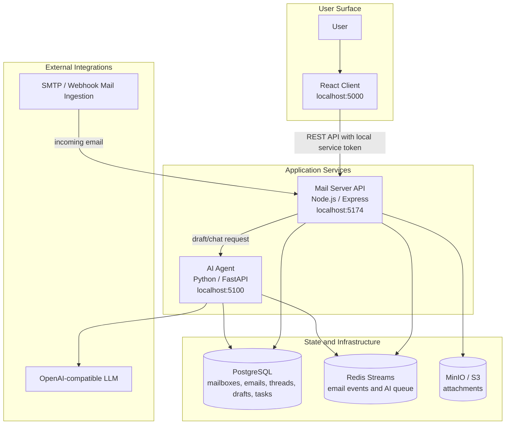
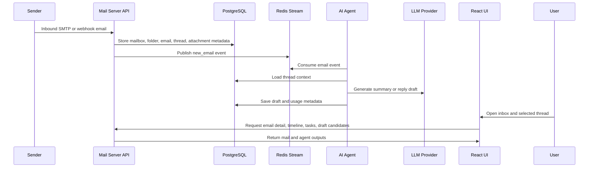
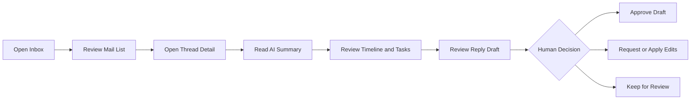
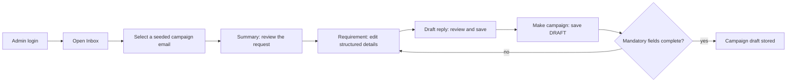

# Agent Mail — Replit Production Source Package

Agent Mail is an Inbox for reviewing Korean campaign request emails and managing summaries, draft replies, requirements, and campaign drafts.

**[한국어 안내는 README.ko.md를 보세요.](README.ko.md)**

Use **this entire folder as the top level of the GitHub repository**. Uploading only `github-version/` would omit the Replit configuration and the Python dependency files.

## 1. Package Status and Scope

- Prepared: **2026-11-03**
- Includes the production build/run path for Replit and administrator login.
- The previous Cloudflare Workers sources and their documentation are preserved.
- Real email sending, real campaign execution, and real AI calls in production are **not enabled**.
- The campaign analysis buttons work against the 9 included scenarios. LLM analysis of arbitrary emails is separate work.
- This package is **source for production deployment** — not a binary bundle or a backup of the current server/database. Dependencies are installed and built on Replit.
- **Not a published, finished release.** In the original workspace, port changes still reverted after restart. This package ships the correct port configuration, but you must verify the actual mapping in any freshly imported environment.
- Mails, saved drafts, sessions, and attachments from the current database are not included. Sample seeding code, static example images, and SQL migrations are included.

> Documentation priority: **this README → the actual Replit run scripts → legacy docs**.
> `github-version/README.md`, `DEPLOYMENT.md`, `OPERATIONS.md` and their sub-documents describe the previous Cloudflare/Docker setup. SMTP/AI/Docker guidance in those legacy docs does not automatically apply to this Replit production path.

## 2. Changelog vs. the Previous Configuration

Differences between the previous Cloudflare/Docker-centric setup and this Replit package. This is a feature-level comparison, not a replacement for the full upstream git history.

| Area | Previous setup | This package |
|---|---|---|
| Production deployment | Cloudflare Workers or separate Node/Python/Docker services | Split Node web/API server for Replit Autoscale |
| Frontend build | Default build using the Cloudflare plugin | Dedicated Replit SPA build, output in `build-replit/client/` |
| Production auth | Cloudflare Access JWT and service auth | Single administrator password with PostgreSQL sessions |
| Login protection | No Replit-specific login path | Password verification, 8-hour sessions, logout, login attempt throttling per 15 minutes |
| Browser auth | Dev proxy and service tokens | No dev tokens in the production build; Secure/HttpOnly cookies |
| Campaign emails | Existing mailbox / generic mail features | Seeding code for 9 LG Electronics / Samsung Electronics / Korean Air scenarios |
| Email bodies | Generic HTML/text bodies | Bodies with products, targets, channels, schedules, requests, and example images |
| Campaign review | Generic mail / AI actions | `Summary`, `Draft reply`, `Requirement`, `Make campaign` |
| Drafts / requirements | Existing mail data model | Campaign workspace with saved edits; missing-information notices |
| Attachments | Dev MinIO/S3 paths | Production requires an external HTTPS S3 config and fails explicitly when unset |
| Real email sending | Existing SMTP code present | Sending, reply-sending, and forwarding blocked on the Replit production path |
| Real AI / mail intake | Python AI/SMTP/webhook code present | Production returns "service not connected" responses; those services are not started |
| DB changes | Existing SQL migrations | Added campaign workspace and web auth migrations; no DDL during production boot |
| GitHub package | App folders only | Top-level Replit config, Korean guide, production CI, file integrity manifest |

Dependency lock files and previous security fixes are included as-is. This does not mean the package passed a new, full security audit.

## 3. Repository Layout

```text
agent-mail-replit/
├── README.md                         # This guide (English)
├── README.ko.md                      # Korean guide
├── VALIDATION.md                     # Package validation results
├── RELEASE-MANIFEST.sha256           # Per-file SHA-256 of the release
├── .replit                           # Dev workflow + production publish config
├── .gitignore / .replitignore
├── .env.example                      # Replit config reference; no real values
├── .github/workflows/
│   └── replit-production.yml          # Tests and production build only
├── pyproject.toml / uv.lock          # Dev Python dependencies
├── src/                              # Auxiliary Python package source
└── github-version/
    ├── client/                       # Inbox UI, shared campaign data, Cloudflare sources
    ├── mail-server/                  # Express API, auth, SQL, tests
    ├── ai-agent/                     # Previous Python AI sources; not started in production
    ├── scripts/
    │   ├── post-merge.sh             # Dependency install
    │   ├── start-replit.sh           # Private dev preview
    │   ├── build-replit.sh           # Replit production SPA build
    │   └── start-production.sh       # Replit production Node server
    ├── pnpm-lock.yaml
    ├── pnpm-workspace.yaml
    ├── package.json
    └── docs/                         # Legacy design and change documents
```

The `docker-version/` replica, `.git` history, developer notes, runtime data, `node_modules/`, `.pythonlibs/`, caches, and previous build outputs were excluded. Original Docker/Cloudflare sources and examples inside `github-version/` remain for compatibility reference.

## 4. Service Architecture

The full-system diagrams below are shared with [`github-version/README.md`](github-version/README.md). They describe the complete application. Which parts actually run depends on the environment — see [Runtime by environment](#runtime-by-environment); on the Replit production path, intake/AI/queue services are intentionally not started.

### Service architecture



### Mail agent workflow



On the Replit production path, the first step (SMTP/webhook intake) and the AI Agent/LLM calls are not connected (`503 SERVICE_NOT_CONFIGURED`). The seeded campaign scenarios power the review actions instead of live LLM analysis.

### User flow

Generic inbox review flow:



Campaign review flow in the current Replit inbox (nothing is sent or published):



### Runtime by environment

| Component | Dev preview (`start-replit.sh`) | Replit production (`start-production.sh`) |
|---|---|---|
| React Client | Vite dev server on `0.0.0.0:5000` | Built SPA served by the single Node web/API server |
| Mail Server API | `127.0.0.1:5174` (internal) | Merged into the web/API server on `0.0.0.0:5000` |
| Browser auth | Dev proxy with fixed local service token (keep private) | Admin password login, PostgreSQL session, Secure/HttpOnly cookie |
| AI Agent (Python) | `127.0.0.1:5100` (internal) | Not started; endpoints return `503 SERVICE_NOT_CONFIGURED` |
| PostgreSQL | Replit-provided dev DB | Replit-provided prod DB; schema promoted via Publishing |
| Redis | Local dev service (events/queue) | Not started |
| MinIO / S3 | Local dev MinIO (`.runtime/`) | Not started; attachments require an external HTTPS S3 config |
| SMTP in/out | Not started | Sending blocked (`403 SENDING_DISABLED`), intake not connected (`503`) |

## 5. Publishing to GitHub

### New, empty repository

Create an empty repository on GitHub, then run from the unpacked folder:

```bash
cd agent-mail-replit
git init -b main
git status --short
git add .
git diff --cached --stat
git commit -m "Prepare Agent Mail for Replit production"
git remote add origin https://github.com/YOUR_OWNER/YOUR_REPOSITORY.git
git push -u origin main
```

Replace `YOUR_OWNER/YOUR_REPOSITORY` with the real repository. Never put passwords or GitHub tokens into commands or the README.

### Existing repository

Clone the existing repository and apply this package **on a new branch**, then review the changes. If the existing repository root uses a `client/`, `mail-server/` layout, it differs from this package's root structure. Do not blindly overwrite existing files and do not replace history with `git push --force`.

This package does not push to GitHub by itself. The top-level CI only runs tests/builds and publishes nothing to Cloudflare or Replit. The nested legacy `.github/` folder is reference-only and does not run unless promoted to the GitHub top level.

## 6. Replit Development Environment

### 6.1 Import and prepare

1. Import the GitHub repository via [Replit Import](https://replit.com/import).
2. Uses Node.js **22**, pnpm **10.32.1**, Python **3.12**, and uv. `.replit` contains the required runtimes and Nix packages such as Redis/MinIO.
3. Make sure a PostgreSQL development database connection is available for this project. Use the provided `DATABASE_URL` and never commit connection values. If you use an existing external DB, do not silently switch to another database.
4. Set the required secrets below **freshly** in Replit Secrets. The ZIP does not contain the original workspace's secret values.
5. Install dependencies from the repository root:

```bash
bash github-version/scripts/post-merge.sh
```

This script installs from the pinned pnpm/uv lock files. It does not initialize the DB or start servers.

### 6.2 Required configuration

| Name | Dev | Prod | Description |
|---|---|---|---|
| `DATABASE_URL` | required | required | PostgreSQL connection for the environment; use the provided Replit-managed DB connection |
| `SESSION_SECRET` | required | required | Sufficiently long random secret, 32+ characters |
| `INBOX_ADMIN_PASSWORD` | unused in dev preview | required | Admin login, 16–1024 chars. Must differ from the session secret |
| `PORT` | set by run scripts | default `5000` | If set explicitly, it must match Networking |
| `S3_ENDPOINT` | dev runner sets local values | required for attachments | Externally reachable HTTPS S3-compatible endpoint |
| `S3_BUCKET` | same | same | External permanent storage bucket |
| `S3_ACCESS_KEY`, `S3_SECRET_KEY` | same | same | Least-privilege bucket credentials |
| `S3_REGION` | optional | optional | Set per your storage provider |

Production `OPENAI_API_KEY` and SMTP passwords are not needed for the current feature scope. Adding values alone does not enable the disabled production AI/sending paths.

`.env.example` is descriptive only. On Replit, use the Secrets/environment management screen. Do not use the example file as real configuration, and never put passwords or keys into `VITE_*` variables.

### 6.3 Development preview

```bash
bash github-version/scripts/start-replit.sh
```

Or start the `Agent Mail` workflow from Run.

- Frontend: `0.0.0.0:5000`
- Internal mail API: `127.0.0.1:5174`
- Internal Python AI API: `127.0.0.1:5100`
- Redis/MinIO: local development services
- Applies required migrations to the **development DB** at startup.

**Keep the dev preview private.** The dev proxy grants fixed local admin privileges. Never use this dev script as the production run command.

## 7. Using the Inbox

### 7.1 Seeding sample campaign emails

Current DB mails are not in the ZIP. In a new environment, seed samples after the DB is ready. If an existing DB is connected, seed only into the intended mailbox.

Open the dev preview or log into the production site, then run this in the same page's browser devtools console. The ID below is the sample mailbox ID from the initial migration; replace it with the real ID when using another mailbox.

```js
const mailboxId = "00000000-0000-0000-0000-000000000001";
const response = await fetch(
  `/api/v1/mailboxes/${encodeURIComponent(mailboxId)}/demo-campaigns/seed`,
  {
    method: "POST",
    headers: { "Content-Type": "application/json" },
    body: JSON.stringify({ refreshContent: false }),
  },
);
if (!response.ok) throw new Error(`Seeding failed: ${response.status}`);
console.log(await response.json());
location.reload();
```

This does not bypass server auth or put passwords in the console. In production it requires a normal login session and a same-origin HTTPS request. Repeated runs do not duplicate existing samples. `refreshContent: true` rewrites existing sample bodies — use it only when you intend to refresh content.

### 7.2 Included scenarios

| Company | Example products/services | Request type |
|---|---|---|
| LG Electronics | OLED, PuriCare, CordZero | New product launch, subscription notice, product notice |
| Samsung Electronics | Galaxy, BESPOKE, Buds | New product launch, subscription notice, product notice |
| Korean Air | New routes, news subscription, Tokyo route | New service notice, subscription notice, route product notice |

Nine total, including `Popup`, `Web push`, and `Inline banner` requests, with product-related bodies and static example images.

These scenarios are not real corporate requests, and the bundled images are examples for campaign review. Before any real advertising or public use, verify trademarks, product images, and content usage rights separately.

### 7.3 The four buttons above each email

1. **Summary**: review the request summary — products, campaign goal, channels, and more.
2. **Draft reply**: review, edit, and save a draft reply. **Does not send email.**
3. **Requirement**: review and edit structured requirements (targets, schedule, links, etc.). Check both confirmed and unverified/missing information.
4. **Make campaign**: stores a campaign **DRAFT** from the requirements. Missing mandatory fields must be filled in. Does not publish popups or send pushes.

If a previously saved campaign draft shows as stale after requirement changes, save it again from the current requirements. The four buttons appear on recognizable sample campaign emails. Do not expect the same AI results to be auto-generated for arbitrary emails.

## 8. Replit Production Build and Publish

### 8.1 Production commands

From the repository root:

```bash
# Build the production frontend + install pinned dependencies
bash github-version/scripts/build-replit.sh

# Run in a production environment already built with DB schema/env ready
bash github-version/scripts/start-production.sh
```

Build output: `github-version/client/build-replit/client/`.

The production runner sets `NODE_ENV=production`, `APP_ENV=production`, `REPLIT_WEB_ENABLED=true`, `RUN_MIGRATIONS=false`, `SMTP_INBOUND_ENABLED=false`. It starts **only the Node web/API server** — no Vite, Redis, MinIO, Python, or SMTP servers.

Production login assumes HTTPS and Secure cookies. Do not test production login over plain `http://localhost` and treat it as equivalent to a real deployment.

### 8.2 Publishing configuration

| Setting | Value |
|---|---|
| Deployment type | Autoscale |
| Build command | `bash github-version/scripts/build-replit.sh` |
| Run command | `bash github-version/scripts/start-production.sh` |
| Public server | `0.0.0.0:5000` |
| External port | **internal 5000 → external 80, one mapping only** |
| Production DB schema changes | review/apply via Publishing's dev→prod schema promotion |

Before publishing, re-check `SESSION_SECRET`, `INBOX_ADMIN_PASSWORD`, and required settings under Publishing's **Production app secrets**. Do not assume a new project/production environment already contains the original workspace's Secrets.

Prepare the development DB schema first, then review the schema changes Publishing proposes. **Do not add migration execution to the production build/start scripts.** The data copy option offered on first publish may differ by DB type/environment. Do not overwrite the current DB just for samples; use the seeded sample API after login if needed.

If deployment region selection is offered, confirm it before the first publish. The region cannot be changed after the first publish. The actual Publish action must be performed by the owner.

### 8.3 Port configuration and the known issue

The package's `.replit` is configured as:

```toml
[[ports]]
localPort = 5000
externalPort = 80

[[ports]]
localPort = 5174
exposeLocalhost = false
```

The 5174 entry is **internal only** and not an external mapping. All other dev services are also explicitly internal-only.

In the original workspace, even with the file change verified, the mapping reverted to `5000 → 5000` and `5174 → 80` after restart. This is not solved by this package. Verify in any newly imported environment:

1. In Networking, confirm only `5000 → 80` remains as the external mapping.
2. Confirm the same setting survives a Run restart.
3. Confirm the default dev address without a port number returns the HTML UI.
4. If the default address returns `401` with `Missing or invalid local service token`, it may be wired to the internal API. Do not remove the auth check; check the mapping.

If the problem reproduces, do not repeat the same file edit and restart. Distinguish the config file values from the actual wiring shown in the Networking panel.

### 8.4 Post-publish checks

- `/health` and `/ready` respond and the DB connection is healthy.
- Logged out: `/` shows the login screen and `/api/v1/mailboxes` returns `401`.
- After admin login, the Inbox and body images open.
- Saving reply/requirement/campaign drafts persists across a refresh.
- After logout, mail API access is blocked again.
- Real email sending returning `403 SENDING_DISABLED` and unconfigured AI/intake paths returning `503 SERVICE_NOT_CONFIGURED` are the current intended behavior.

A `200` on `/` alone does not mean login setup or all features are ready. The info page renders even when the admin password is missing or too short, while the mail API stays locked.

## 9. Operations and Security Notes

### Login and access

- The current model is a **single administrator shared Inbox**. Per-user accounts, organization separation, and MFA are out of scope.
- Session cookies use Secure/HttpOnly/SameSite attributes. The DB stores hashes instead of raw session tokens.
- Login sessions expire after 8 hours; logout revokes the server session.
- Changing `SESSION_SECRET` or the admin password and applying it to the production app invalidates existing sessions.
- Login attempt throttling is stored in PostgreSQL. After repeated failures, retry in 15 minutes.
- Production write requests require a same-origin HTTPS Origin. Arbitrary user-identity headers or dev Bearer tokens cannot gain production privileges.
- The original Cloudflare Access path is separate and was not replaced by the Replit admin-password scheme.

### Data and attachments

- Mails, drafts, workspaces, and login sessions are stored in the respective PostgreSQL database.
- Before schema changes, verify backup/restore options; manage production data access and retention policy separately.
- `.runtime/` data from the dev MinIO is not auto-copied to production.
- Without an external permanent S3 store, attachment operations fail with `503 STORAGE_NOT_CONFIGURED`. **Real attachment operation is incomplete.**
- When moving existing attachment objects, preserve both the DB object keys and the actual files, and verify download permissions.
- Static images under `/campaign-examples/` are public so they load inside the email's sandboxed HTML frame. User attachments are never exposed on that path.

### Troubleshooting

| Symptom | Check |
|---|---|
| Default address returns the API's `401` | Whether Networking is wired to the internal API instead of 5000 |
| Password setup info screen | Production secret presence, password length, whether the new config was applied |
| Login screen reappears after login | HTTPS, cookies, external host, DB/session state |
| `relation does not exist` | Dev schema preparation and Publishing's production schema promotion |
| Inbox is empty | A new DB has no original mails; check mailbox/sample seeding |
| AI/mail intake `503` | Intentionally not connected in the current production scope |
| Attachments `503` | Permanent S3 config and existing object migration needed |
| Local MinIO bucket warning | Dev storage health; does not mean production storage is ready |

Never log passwords, connection strings, or session tokens. After fixes, re-run/re-publish the environment and verify the actual login/save paths.

## 10. Testing and File Verification

```bash
# From the repository root
pnpm --dir github-version install --frozen-lockfile
pnpm --dir github-version test
bash -n github-version/scripts/build-replit.sh
bash -n github-version/scripts/start-production.sh
bash github-version/scripts/build-replit.sh

# Verify integrity of the first downloaded source
sha256sum -c RELEASE-MANIFEST.sha256
```

GitHub Actions runs the Mail Server tests and the Replit production build. It performs no DB migrations or deployments, and it does not replace the legacy Cloudflare integration tests or Python tests.

`VALIDATION.md` records which checks were actually run for this package and which were not. After modifying sources, checksums differing from the first release is expected.

## 11. Source, License, and References

- Previous project overview: [`github-version/README.md`](github-version/README.md)
- Previous development docs: [`github-version/DEVELOPMENT.md`](github-version/DEVELOPMENT.md)
- Previous deployment docs: [`github-version/DEPLOYMENT.md`](github-version/DEPLOYMENT.md)
- Previous operations docs: [`github-version/OPERATIONS.md`](github-version/OPERATIONS.md)
- Inbox AI scope: [`github-version/client/docs/inbox-ai-spec.md`](github-version/client/docs/inbox-ai-spec.md)
- Preserved client license: [`github-version/client/LICENSE`](github-version/client/LICENSE)
- [Replit port configuration](https://docs.replit.com/features/project-setup/ports)
- [Replit dev/prod databases](https://docs.replit.com/features/data-and-storage/development-and-production)
- [Replit Secrets](https://docs.replit.com/core-concepts/project-editor/app-setup/secrets)

Original copyright and license notices are preserved. This package does not separately grant usage rights for any images or trademarks.
