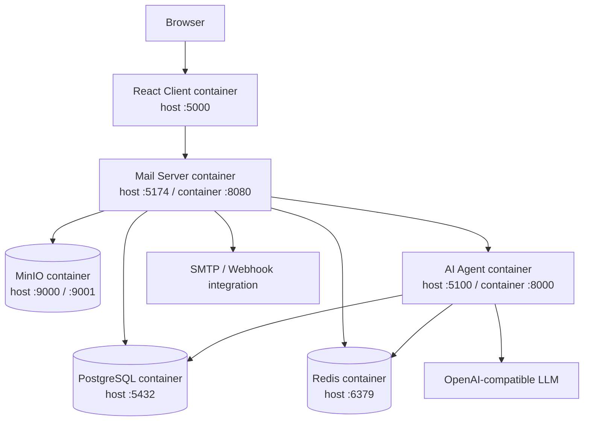
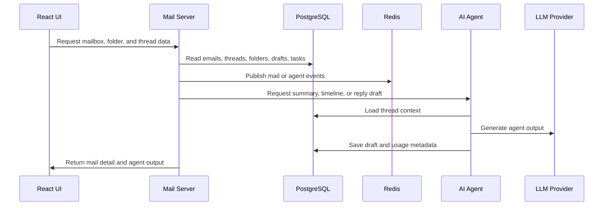

# Agent Mail Docker Version

This package is the Docker-oriented release of Agent Mail. It mirrors the GitHub package while emphasizing server handoff and Docker Compose operation.

Agent Mail is a self-hosted email operations workspace with a React inbox UI, a Node.js Mail Server API, a Python AI Agent, PostgreSQL, Redis, and optional MinIO object storage.

## Runtime Ports

- React UI: `http://localhost:5000`
- Mail Server API: `http://localhost:5174`
- AI Agent API: `http://localhost:5100`
- PostgreSQL: `localhost:5432`
- Redis: `localhost:6379`
- MinIO API: `localhost:9000`
- MinIO Console: `http://localhost:9001`

## Docker Service Flow



## Mail Processing Flow



## Quick Start

```bash
cp .env.example .env
pnpm install
pnpm build
scripts/start-docker.sh
```

Open the UI:

```text
http://localhost:5000/
```

Run health checks:

```bash
scripts/healthcheck.sh
```

## Configuration

Update `.env` before production use:

- `LOCAL_SERVICE_TOKEN`
- `ADMIN_EMAILS`
- `APP_DOMAINS`
- `WEBHOOK_SECRET`
- `OPENAI_API_KEY`
- `POSTGRES_PASSWORD`
- `S3_ACCESS_KEY`
- `S3_SECRET_KEY`

Do not commit `.env`.

## API Authentication

Most API routes require:

```text
Authorization: Bearer $LOCAL_SERVICE_TOKEN
```

Readiness routes:

```bash
curl http://localhost:5174/ready
curl http://localhost:5100/ready
```

## Update Contents

- English Docker README prepared for server handoff.
- Mermaid service architecture and mail processing diagrams added.
- Runtime ports, startup commands, configuration, and authentication documented.
- Docker Compose package kept synchronized with the GitHub package.

## Verification Commands

```bash
bash -n scripts/start-docker.sh scripts/start-local.sh scripts/healthcheck.sh
docker-compose config
scripts/healthcheck.sh
```
