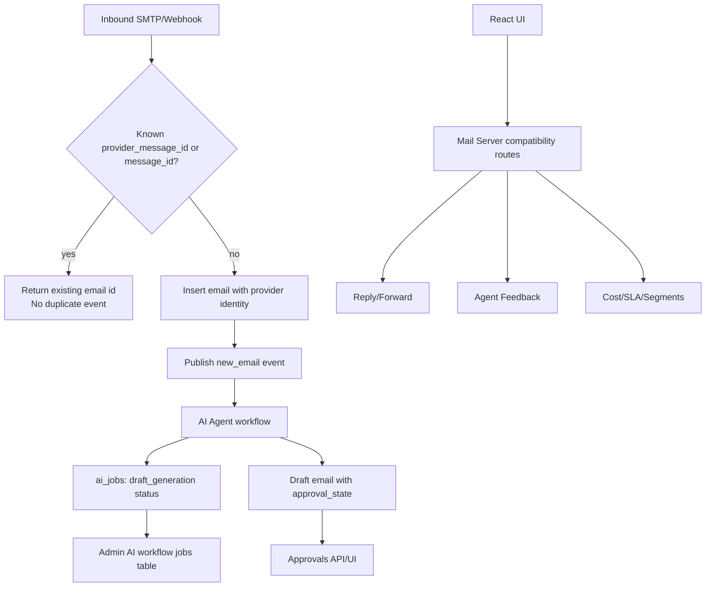

# 2026-06-04 Agent Mail Operational Contracts

## Scope

- Target folders:
  - `v1-present-release/github-version`
  - `v1-present-release/docker-version`
- Change type: backend API compatibility, inbound mail idempotency, AI workflow observability, Docker runtime hardening, CI/documentation alignment.

## Source Baseline

- Frontend API client called routes that the Express Mail Server did not expose: `agent-feedback`, `approvals`, `admin/cost`, `segments`, `admin/sla`, `reply`, and `forward`.
- Inbound webhook/SMTP email creation used generated IDs for every delivery and did not deduplicate by provider/message identity.
- Docker client image used the development Vite server path.
- CI documentation and actual CI scope were inconsistent.
- Draft generation existed, but job-level operational records for retry/DLQ-style UI were incomplete.

## Applied Changes

- Added Mail Server compatibility routes for the current React UI:
  - reply and forward send endpoints
  - agent feedback create/delete/summary endpoints
  - draft approval endpoints
  - admin cost daily/monthly/model endpoints
  - mailbox segment and SLA endpoints
- Added `004_operational_contracts.sql`:
  - `emails.provider`
  - `emails.provider_message_id`
  - `emails.approval_state`
  - `emails.approval_meta`
  - provider/message unique indexes
  - `agent_feedback`
  - `ai_jobs`
- Reworked inbound email persistence through `upsertInboundEmail()`:
  - provider identity first: `mailbox_id + provider + provider_message_id`
  - fallback identity: `mailbox_id + message_id`
  - webhook and SMTP now publish `new_email` only on first insert.
- Added AI workflow job tracking:
  - `summary`, `timeline`, `task_extraction`, and `draft_generation` job rows are created, completed, failed, or blocked.
  - Summary/timeline/task extraction results are stored on the source email row for detail API consumption.
  - Admin overview exposes recent AI jobs.
  - Admin UI shows an AI workflow jobs table.
- Changed client Docker image from dev server to production build plus Vite preview.
- Added preview proxy config for `/api` and `/agents`.
- Updated CI to install workspace dependencies once and run:
  - Mail Server tests
  - React client typecheck
  - React client production build
  - Python AI Agent checks
- Updated migration startup handling so Docker entrypoint-applied schemas can be baselined into `schema_migrations`, then newer migrations can still apply.

## Service Flow

## Explicit Non-Changed Areas

- This update does not add Gmail or Microsoft Graph OAuth connectors.
- Retry controls are not yet wired to requeue a selected failed job from the UI.
- Docker daemon image build could not be verified because the local Docker daemon was not reachable.

## Verification Performed

- `pnpm --filter agentic-inbox-mail-server test`
- `pnpm --filter @agent-mail/client typecheck`
- `pnpm --filter @agent-mail/client build`
- `node --check` for Mail Server entrypoint, migration runner, inbound email helper, compatibility routes, and SMTP ingestion.
- `python3 -m py_compile ai-agent/main.py`
- `docker-compose config` for both release folders.
- `bash -n scripts/start-docker.sh scripts/start-local.sh scripts/healthcheck.sh`
- Same core test/build checks were run in both `github-version` and `docker-version`.

## Remaining Risks

- Docker image build still needs to be rerun once Docker/Colima is running.
- AI workflow jobs now execute for `summary`, `timeline`, `task_extraction`, and `draft_generation`, but failed-job retry is visible as status data only and does not yet have a UI requeue action.
- Existing databases should be checked after startup to confirm `004_operational_contracts.sql` has been applied.
