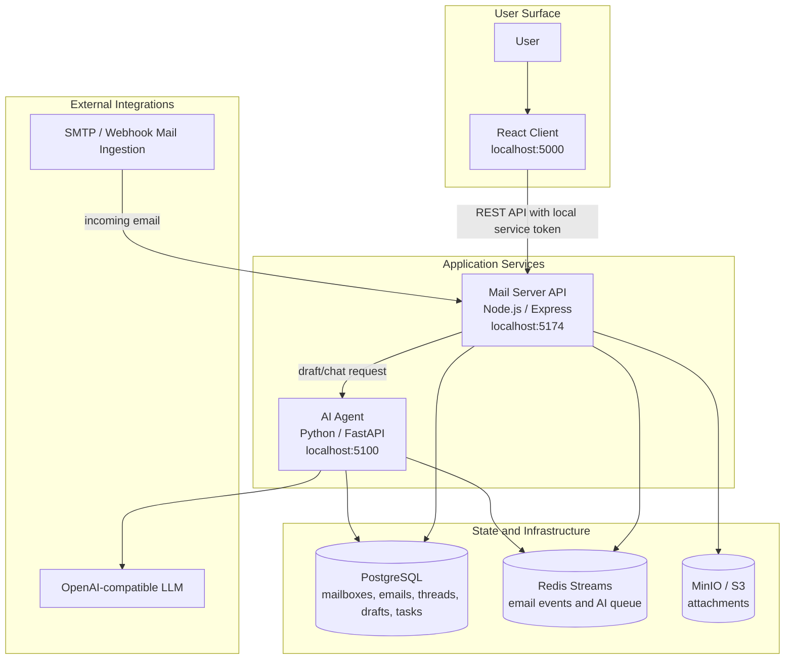
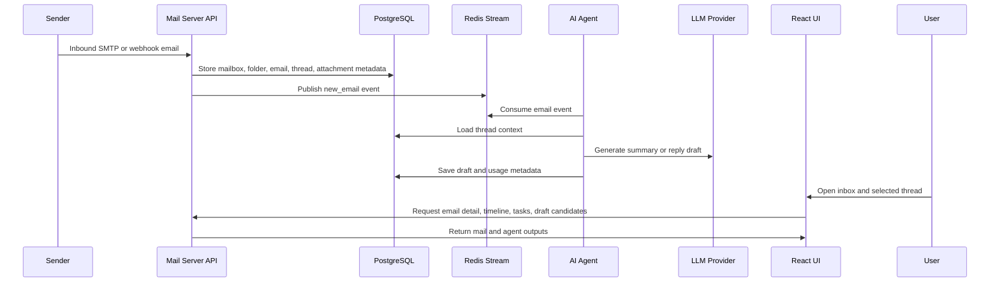
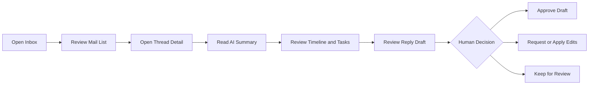

# Agent Mail

Agent Mail is a self-hosted email operations workspace for receiving mail, reviewing inbox threads, generating AI-assisted summaries and draft replies, and operating the queue through a browser UI.

This package is prepared as the GitHub repository root for `https://github.com/younghai/Agent-mail`. It includes the React client, Node.js Mail Server API, Python AI Agent, PostgreSQL/Redis/MinIO Docker runtime, startup scripts, CI, and English deployment documentation.

## Runtime Ports

- React UI: `http://localhost:5000`
- Mail Server API: `http://localhost:5174`
- AI Agent API: `http://localhost:5100`
- PostgreSQL: `localhost:5432`
- Redis: `localhost:6379`
- MinIO API: `localhost:9000`
- MinIO Console: `http://localhost:9001`

## Repository Layout

```text
.
├── client/              # React Router inbox UI and operations workspace
├── mail-server/         # Node.js API, migrations, mail operations, SMTP helpers
├── ai-agent/            # Python FastAPI draft generation and assistant service
├── scripts/             # Docker/local startup and health checks
├── docker-compose.yml   # Full local service runtime
├── package.json         # pnpm workspace commands
├── pnpm-lock.yaml
└── pnpm-workspace.yaml
```

## Service Architecture



## Mail Agent Workflow



## User Flow



## Quick Start With Docker

```bash
cp .env.example .env
pnpm install
pnpm build
scripts/start-docker.sh
```

Open the UI:

```text
http://localhost:5000/
```

Run health checks:

```bash
scripts/healthcheck.sh
```

## Local Development Without Docker

Local development requires PostgreSQL and Redis to already be available.

```bash
cp .env.example .env
pnpm install
scripts/start-local.sh
```

Useful workspace commands:

```bash
pnpm build
pnpm typecheck
pnpm test
pnpm dev:client
pnpm dev:api
```

## Configuration

Update `.env` before real use:

- `LOCAL_SERVICE_TOKEN`
- `ADMIN_EMAILS`
- `TEAM_DOMAIN` and `POLICY_AUD` (required for production administrator identity)
- `APP_DOMAINS`
- `WEBHOOK_SECRET`
- `OPENAI_API_KEY`
- `POSTGRES_PASSWORD`
- `S3_ACCESS_KEY`
- `S3_SECRET_KEY`

Do not commit `.env`.

## API Authentication

Most API routes require:

```text
Authorization: Bearer $LOCAL_SERVICE_TOKEN
```

The service token authenticates the proxy/service, **not a user**. Production
admin access also requires a signed Cloudflare Access JWT in
`cf-access-jwt-assertion`. The mail server verifies its signature, issuer,
audience, subject and expiration using `TEAM_DOMAIN` (the HTTPS Access team URL
or certs URL) and `POLICY_AUD`. Only the verified JWT's email is compared with
`ADMIN_EMAILS`; plain email identity headers are ignored and stripped by the
standalone proxy. Forward the signed assertion from Access to the mail server.
Missing user identity cannot read admin data or perform admin-only writes.
Verified non-admin teammates retain the existing viewer permissions.

Without Access configuration, local development uses the fixed identity
`local-admin@example.local`; an empty admin allowlist grants that local identity
admin access. Caller headers cannot select another local identity. Keep this
development mode private and use `NODE_ENV=production` plus Access configuration
for production. A production-built Worker no longer bypasses Access based on a
localhost URL; use the development build for local-only access.

Readiness routes are public:

```bash
curl http://localhost:5174/ready
curl http://localhost:5100/ready
```

Authenticated mailbox check:

```bash
source .env
curl -H "Authorization: Bearer $LOCAL_SERVICE_TOKEN" \
  http://localhost:5174/api/v1/mailboxes
```

## Release Updates Included

- English README prepared for GitHub publication.
- Mermaid service architecture, mail agent workflow, and user flow diagrams.
- Docker and local startup paths documented.
- Runtime ports and service responsibilities documented.
- GitHub Actions CI included for Mail Server, React client, Python AI Agent, and secret hygiene.
- Source package hygiene enforced through `.gitignore`.

## Verification Commands

```bash
bash -n scripts/start-docker.sh scripts/start-local.sh scripts/healthcheck.sh
docker-compose config
pnpm --filter agentic-inbox-mail-server test
pnpm --filter @agent-mail/client typecheck
pnpm build
```

## GitHub Push

This folder is already configured for:

```text
https://github.com/younghai/Agent-mail.git
```

Suggested publish flow:

```bash
git status
git add .
git commit -m "Document Agent Mail service flow"
git push origin main
```
